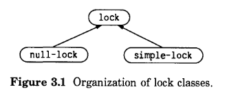
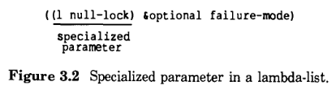
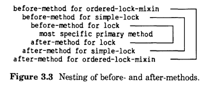

# 3 开发一个简单的CLOS程序：锁

本章通过演示一个示例应用程序的开发过程，展现CLOS编程的强大功能。我们首先定义类并建立反映类之间关系的组织架构，随后定义规定客户端如何创建和操作这些类对象的接口，最后定义实现层——即支撑该接口的Lisp代码。接口由一组泛型函数构成，而实现则包含这些泛型函数的具体方法。接口声明了对这些对象可执行的操作，实现则阐述了这些操作在内部的具体运作机制。

在本章中，我们将从不同视角审视这个程序：以程序员身份设计与开发它；以客户端身份使用它；最后像CLOS自身那样分析其内部组件的交互机制。

## 3.1 锁的概述

这个示例程序的目标是实现锁机制——用于控制对共享资源并发访问的对象。例如在会议中，需要确保任意时刻只有一人发言。"史密斯先生获得发言权"这样的表述表明，"发言权"（共享资源）受到保护以避免被他人同时使用。在本示例中，我们使用"获取"来描述获得锁的行为，用"释放"来表示放弃锁。

锁机制仅在多进程可能同时竞争同一资源的环境中具有意义。此处所说的进程是指单个Lisp环境中多个独立的控制线程。锁用于确保共享资源以一致的方式被访问。在访问资源前，进程应当先获取与之关联的锁；使用完毕后，进程则应释放该锁。

我们注意到进程并非Common Lisp的标准组成部分，在没有多进程的Common Lisp实现中，这个示例程序可能缺乏实际意义。然而，我们的目标并非开发一个适用于所有环境的通用程序，而是希望通过这个简单示例展示面向对象的编程风格。因此，即使锁机制在您当前的Common Lisp环境中并无用武之地，也请您继续阅读。

我们将已被获取但尚未释放的锁称为"忙碌"状态，而可供获取的锁则称为"空闲"状态。当锁处于忙碌状态时，获取该锁的进程即称为其"所有者"。

我们将把锁实现为 Lisp 对象。锁的接口必须包含以下操作:

| Operations | Describe                                |
| ---------- | --------------------------------------- |
| Create     | 创建一个新的锁                             |
| Seize      | 获取一个锁。如果成功，返回一个锁对象。         |
| Release    | 释放一个锁，如果该锁属于正在试图释放它的同一进程。|

锁存在多种可能类型，我们希望锁程序具备可扩展性，因为后续计划支持更复杂的锁类型。例如，我们最终可能需要一种能避免死锁情况的锁（当一个人拿起黄油碟并伸手去拿黄油刀，而另一个人同时拿起黄油刀并伸手去拿黄油碟时，就会发生死锁——除非对方完成动作，否则双方都无法获得黄油）。

我们首先定义两种基础锁类型，后续可将其作为构建其他锁类型的基石。

| Type        | Describe   |
| --------    | --------   |
| Simple lock | 这种锁具有`name`属性，其状态分为忙碌或空闲两种。当锁处于忙碌状态时，会记录其所有者——即某个进程。|
| Null lock   | 这种锁虽具有名称属性，但不会记录其忙碌或空闲状态。实际上，空锁始终处于空闲状态。它支持常规的锁定操作，却不会真正阻止被其他所有者获取。这类锁使得程序能够统一处理某些时而需要防并发访问、时而又无需保护的资源——程序执行全套获取与释放锁的流程，而锁的类型（空锁或其他类型）则控制着资源是否实际受到保护。 |

## 3.2 定义对象的种类——类

现在我们需要将空锁和简单锁的文字描述转化为CLOS的语言。这种转化展示了

- 设计一个使用继承的程序
- 使用槽存储状态信息
- 用 `defclass` 宏定义类
- 请求读写槽的方法
- 给槽一个默认的初始值

### 选择表示锁的类

虽然乍看之下我们似乎应该定义两个类（一个表示简单锁，另一个表示空锁），但通过采用图3.1所示的三个类的继承结构，我们能更充分地利用继承优势。



`simple-lock` 类和 `null-lock` 类在它们的定义中包含了`lock`类;我们说它们是在 `lock` 类的基础上构建的。它们都继承自 `lock` 类。这里有一个术语提示:

> lock 是 null-lock 的直接超类
> lock 是 simple-lock 的直接超类
> null-lock 是 lock 的直接子类
> simple-lock 是 lock 的直接子类

我们把 `lock` 称作基础类。术语“基础类”没有技术上的特殊意义(`lock` 类的行为和其他类没有什么不同)，仅仅是描述了类的用途。`lock` 类是所有锁的基础,它存在的意义是提供所有锁共有的特征。所有锁共同的特征就是它们都是锁这一事实。通过让所有锁类都建立在名为`lock`的类之上，我们可以使用`(typep object 'lock)`来判断一个对象是否为锁。

此外，简单锁和空锁都具有名称属性，因此"名称特性"由lock类提供并被所有类型的锁继承。提供基础类的另一个原因是为了方便定义默认方法。附加在基础类上的方法就是默认方法，任何继承该基础类的类都可以选择使用这个默认方法、提供新方法来覆盖默认方法，或者通过提供前置方法或后置方法来支持额外行为。总之，我们定义lock类基于三个原因：

- 它使我们能够使用`(typep object 'lock)`来检查一个对象是否为锁
- 它为所有锁提供"name"特征
- 它支持所有锁的默认行为

我们并不打算让这个类独立存在，因为不期望直接创建它的实例。lock类将不会配备完整的方法集来支持锁定协议。

### 使用defclass

`lock` 类的定义如下：

```lisp
(defclass lock ()
  ((name :initarg :name :reader lock-name))
  (:documentation "The foundation of all locks."))
```

执行此表单将创建一个名为`lock`的新类，该类包含一个名为`name`的槽。同时会创建泛型函数`lock-name`，以及一个用于读取任何`lock`类型对象`name`槽值的方法。下面我们逐项分析类定义的各个部分及其功能：

> `defclass` 

用于定义新类的宏

> `lock`

类的名字

> `()`

直接超类的列表，这里的列表是空的，因为我们没有为 lock 指定任何超类

> `((name :initarg :name :reader lock-name))`

槽指示符的列表。每个槽指示符可以是一个符号(槽名)或者是一个列表(槽名后跟着槽选项)。这里我们定义了一个名为 `name` 的槽，有两个槽选项:

> `:initarg :name`	

这个选项使得在创建实例时可以初始化这个槽的值。要初始化 `name` 槽，可以给`make-instance`指定`:name`关键字参数。(注意，`make-instance`是CLOS函数，用于创建新实例;我们将在[使用make-instance或构造函数](#33-创建新对象实例)中进行讨论。)

> `:reader lock-name`

这个选项允许使用泛型函数 `lock-name` 来读取这个槽的值。这个槽选项导致CLOS系统为 `lock-name` 自动生成了一个方法，`lock-name` 被称为读取器泛型函数。

> `(:documentation "The foundation of all locks.")` 

这是一个类选项;它适用于整个类。`:documentation`选项提供一个用于描述类的用途的文档字符串。您可以通过调用 `documentation` 函数来检索类的文档字符串。

### 从超类继承

`null-lock` 的定义说明了如何在超类基础上定义一个子类。这里的 `null-lock` 类构建在一个超类即`lock` 类之上。

```lisp
(defclass null-lock (lock)
  ()
  (:documentation "A lock that is always free."))
```

`null-lock`类从它的超类锁继承了以下内容:

- `name` 槽	- 每一个 `null-lock` 的实例都有一个叫做 `name` 的槽

- 槽选项 `:initarg :name` - 您可以在创建 `null-lock` 实例时初始化 `name` 槽。

- `lock-name`方法 - 您可以在`null-lock`的实例上使用读取器 `lock-name` 来读取`name`槽的值。

### 访问器

现在我们来定义`simple-lock`类。简单锁需要记录自身处于忙碌或空闲状态。该定义通过提供`owner`槽来实现这一功能，该槽会记录当前拥有锁的进程，从而表明简单锁的状态：空闲锁的`owner`槽设为`nil`，而忙碌锁的`owner`槽则设为当前持有锁的进程。

```lisp
(defclass simple-lock (lock)
  ((owner :initform nil :accessor lock-owner))
  (:documentation "A lock that is either free or busy."))
```

`simple-lock`类从`lock`类继承了与`null-lock`完全相同的特征和行为。请注意，`simple-lock` 类从它的超类继承了`name`槽，并添加了自己的槽，即`owner`槽。`simple-lock`的定义还包括两个新的槽选项:

> `:initform nil`

这个槽选项允许您为槽提供一个默认的初始值。这里的`owner` 槽的默认初始值为 `nil`。这意味着，当创建一个 `simple-lock` 对象时，它默认是空闲的。

> `:accessor lock-owner`

此槽选项使您能够访问`owner`槽，以便读取或写入槽值。CLOS会生成两个泛型函数：一个名为`lock-owner`的读取器泛型函数，以及对应的写入器泛型函数。CLOS还会为每个泛型函数定义相应方法。因此，您可以通过读取器泛型函数`lock-owner`来读取槽值，也可以通过`setf`结合`lock-owner`来写入槽值。

这个读取器泛型函数的名字是符号 `lock-owner` 。要调用读取器，请使用普通的函数调用语法，例如:

    (lock-owner lock-object)
	
写入器泛型函数的名字是 `(setf lock-owner)`。这个列表不是一个合法的表达式;它只是函数的名字——换句话说，它是“函数说明符”。要调用写入器，应该使用下面的`setf`语法:

    (setf (lock-owner lock-object) new-value)
	
槽选项`:reader`和 `:accessor` 是相似的。`reader` 选项仅仅生成读取器方法。`:accessor` 选项生成两个方法:一个用于读取器，一个用于写入器。术语 *访问器泛型函数* 是一个综合性术语，它包括读取器和写入器。通常，如果只需要读取槽，则只需要定义读取器;如果要读写槽，则需要定义两种访问器。

## lock类中的槽

下面我们回顾一下如何使用 `name` 和 `owner` 槽，并将其与所选择的槽选项关联起来:

`name`： 每个锁都有一个名字。在创建锁时，将其作为参数传递给 `make-instance` 来初始化名字。我们没有为 `name` 槽提供默认的初始值，因为这么做没有什么意义; 每一个锁都应当有一个符合其用途的名字，不提供默认值是合适的。

我们可以使用读取器 `lock-name` 来确定锁的名字。我们没有提供改变锁名的方法，没有针对锁名的写入方法。

`owner`： 每个 `simple-lock` 都有一个所有者。当创建 `simple-lock` 时，`owner` 槽总是初始化为`nil`。我们不允许这个槽被 `make-instance` 的参数初始化，因为我们希望所有新创建的简单锁都是空闲的。

我们可以使用读取器`lock-owner`来查询简单锁的所有者。通过对应的`lock-owner`写入器方法可以更改简单锁的所有者。该写入器命名为`(setf lock-owner)`。这个写入器方法在获取锁的`seize` 方法内部会很有用，但我们不打算将其作为接口的一部分。

尽管`:initform`和`:initarg`的名字类似，但它们有不同的用途。`:initarg`选项允许您为`make-instance`提供一个参数来初始化槽的值。因此，使用这个槽选项使得`make-instance`的调用者能够为槽指定一个初始值。对于 `name` 槽，我们使用的是`:initarg`。

相反，`:initform`为槽提供了一个默认的初始值。该槽被初始化为`:initform`选项中指定的值，而不是由`make-instance`的参数初始化。对于`owner`槽，我们使用的是 `:initform`。

## 3.3 创建新对象——实例

如果我们创建一些锁并对它们进行一些操作，我们编写的代码会感觉更真实。在下面的小节中，我们将创建`simple-lock`和`null-lock`的实例，并对它们进行实验。

### 使用make-instance或构造函数

创建新实例的函数是`make-instance`。下面我们使用`make-instance`创建一个空锁，并将它的`name` 槽初始化为`"null lock"`:

```lisp
(setq *null-lock*
      (make-instance 'null-lock :name "Null lock"))
=> #<NULL-LOCK 802335>
```

接下来我们使用`make-instance`来创建一个 simple-lock，并将它的 `name` 槽初始化为`"Simple lock"`:

```lisp
(setq *simple-lock*
      (make-instance 'simple-lock :name "Simple lock"))
=> #<SIMPLE-LOCK 802393>
```

你可以使用`make-instance`创建一个类的实例。第一个参数是类的名字。后面的参数是初始化参数，参数后面跟着值。这里的初始化参数`:name`用一个值初始化了 `name` 槽。

我们建议您定义供客户端使用的构造函数来创建实例。构造函数是针对特定类创建实例的定制化方式，其名称通常描述了所创建实例的类型。与`make-instance`相比，构造函数提供了更抽象的外部接口，因为其名称描述的是更高层次的目的（创建空锁），而非内部实现（创建空锁类的实例）。

另一个优势在于构造函数可以设定必需参数。相比之下，`make-instance`除第一个参数外的所有参数都是可选的。我们可能更希望要求用户必须初始化锁的名称。

您可以通过`defun`定义构造函数，并在函数体中调用`make-instance`。例如，这里我们定义了两个构造函数：一个用于创建空锁，另一个用于创建简单锁：

```lisp
(defun make-null-lock (name)
  (make-instance 'null-lock :name name))

(defun make-simple-lock (name)
  (make-instance 'simple-lock :name name))
```

### 使用访问器

我们将把`make-null-lock`和`make-simple-lock`作为接口的一部分，供客户端在创建新锁时使用。因此，客户端使用构造函数而不是`make-instance`:

```lisp
(make-null-lock "Null lock")
(make-simple-lock "Simple lock")
```

我们可以试验这些通过`defclass`的`:reader`和`:accessor`选项自动生成的读取器与写入器泛型函数。

我们有一个读取器泛型函数`lock-name`及其对应方法。该方法附加在`lock`类上，并被`null-lock`和`simple-lock`继承，因为它们都建立在`lock`类的基础之上。

```lisp
(lock-name *null-lock*)   => "Null lock"
(lock-name *simple-lock*) => "Simple lock"
```

我们还有一个名为`lock-owner`的读取器泛型函数，以及相应的写入器泛型函数`(setf lock-owner)`。这些访问器都有一个附着到`simple-lock`类的方法。我们可以在`simple-lock`的实例上使用这些访问器。

在下面的例子中，我们在新创建的简单锁上使用`lock-owner`，这表明`owner`槽的初始值为`nil`。然后，我们调用写入器泛型函数将槽的值设置为`3401`，然后再次调用读取器来查看该值是否确实为`3401`。

```lisp
(lock-owner *simple-lock*)               => nil
(setf (lock-owner *simple-lock*) 3401)   => 3401
(lock-owner *simple-lock*)               => 3401
```

我们无法对`null-lock`的实例使用`lock-owner`或`(setf lock-owner)`。这些泛型函数没有附加到`null-lock`类的方法，且`null-lock`也未继承任何相关方法。因此，若尝试对`null-lock`实例使用这些泛型函数，CLOS将触发"no applicable method"错误。

```lisp
(lock-owner *null-lock*)
ERROR:  No applicable method for LOCK-OWNER
for the argument #<NULL-LOCK 802335>

(setf (lock-owner *null-lock*) 3401)
ERROR:  No applicable method for (SETF LOCK-OWNER)
for the argument #<NULL-LOCK 802335>
```

### 查询锁的类型

现在我们有了实例，可以演示CLOS如何与现有Common Lisp类型体系完美集成。所有类的名称都是Common Lisp类型说明符，因此您可以使用`type-of`和`typep`来查询Lisp对象的类型。实例的类型就是其所属的类。

```lisp
(type-of *null-lock*)               => NULL-LOCK
(type-of *simple-lock*)             => SIMPLE-LOCK

(typep *simple-lock* 'simple-lock)  => t
(typep *simple-lock* 'lock)         => t
(typep *simple-lock* 't)            => t
```

如示例所示，我们使用`typep`来表明`*simple-lock*`不仅是`simple-lock`类型，同时也属于`lock`类型和`t`类型。这与`typep`处理其他Common Lisp类型说明符的方式完全一致——当某个类型是另一类型的子类型时亦然。例如，`integer`类型的对象也属于`number`类型，因为`integer`是`number`的子类型。同理，所有对象都属于`t`类型。

这一点的重要性与继承机制密切相关。实例`*simple-lock*`同时具有`simple-lock`、`lock`和`t`三种类型，这意味着每个类都能为`*simple-lock*`贡献结构和行为。因此，我们可以通过`typep`来查询特定类是否会影响某个实例的行为表现。

类似地，要找出一个类与另一个类的关系，可以对类使用`subtypep`:

```lisp
(subtypep 'simple-lock 'lock)      => t
(subtypep 'null-lock 'lock)        => t
(subtypep 'null-lock 'simple-lock) => nil t
```

结果证实了我们已经知道的:`simple-lock`是`lock`的子类型，`null-lock`是`lock`的子类型，而`null-lock`不是`simple-lock`的子类型。

`subtypep`的第一个值表示第一个参数是否是第二个参数的子类型。`subtypep`的第二个值表示第一个值的确定性。如果不知道这两种类型之间的关系，则值将为`nil nil`。这种情况可能发生在 COMMON LISP 类型中，但不可能发生在两个类中。当`subtypep`的两个参数都是类名时，第二个返回值总是`t`。

## 3.4 定义接口——泛型函数

通过为客户端提供创建新锁的构造函数，我们已经完成了接口的一部分。每种锁都有自己的构造函数来创建新锁。构造函数`make-simple-lock`创建一个简单锁，`make-null-lock`创建一个空锁。构造函数是普通函数，而不是泛型函数。

一旦创建了锁，它必须支持两个锁操作:`seize`和`release`。我们将把这些操作实现为泛型函数。

### 使用defgeneric记录接口规范

我们可以通过`defgeneric`形式来记录每个泛型函数的接口规范。该接口包含三个核心概念，每个概念都在`defgeneric`形式中有所体现：

| 接口        | defgeneric 的描述     |
| ---        | ---                  |
| 预期的参数   | lambda-list 中的参数  |
| 它能做什么   | 文档字符串            |
| 它的返回值   | 文档字符串            |

您可以使用`defgeneric`来为泛型函数编写文档，以方便调用该函数或为其定义额外方法的程序员。`defgeneric`形式同时为泛型函数设定了规范，任何未来的程序扩展都必须遵循这些准则。

`defgeneric`形式从整体上描述泛型函数。针对`seize`和`release`的`defgeneric`形式在文档字符串中提供了英文描述，阐明该泛型函数的总体用途。文档字符串并非程序的功能性组成部分，它实际上不执行任何操作。但若缺少这些文档，阅读代码并想了解程序工作原理的人就不得不查看所有方法定义，并尝试通过方法集合来推断泛型函数的整体目的。

```lisp
(defgeneric seize (lock)
  (:documentation
   "Seizes the lock.
Returns the lock when the operation succeeds.
Some locks simply wait until they can succeed, while
other locks return NIL if they fail."))

(defgeneric release (lock &optional failure-mode)
  (:documentation
   "Releases the lock if it is currently owned by this process.
Returns T if the operation succeeds.
If unsuccessful and failure-mode is :no-error, returns NIL.
if unsuccessful and failure-mode is :error, signals an error.
The default for failure-mode is :no-error."))
```

在Lisp中，lambda-list是函数中用于指定参数名称的部分。`seize`的`defgeneric`形式规定了一个必需参数（名为`lock`），而`release`的`defgeneric`形式则规定了一个名为`lock`的必需参数和一个名为`failure-mode`的可选参数。

这些文档字符串的显示格式看起来有些别扭，但我们将其左对齐是有原因的。如果进行缩进，`documentation`函数会保留这些缩进，而这并非我们想要的效果。虽然文档字符串的首行不必须左对齐，但我们对多行文档字符串统一采用这种风格，以保持与后续行格式的一致性。

### 创建一个泛型函数

`defgeneric`形式用于创建新的泛型函数。但这不是定义泛型函数的唯一方式，另一种途径是通过定义方法来实现。当你为某个尚不存在的泛型函数定义方法时，CLOS会自动创建该泛型函数。此时泛型函数的lambda-list将源自该方法的lambda-list。后续你可以使用`defgeneric`来指定泛型函数的lambda-list、文档字符串及其他选项；CLOS会根据新的`defgeneric`定义来修改已存在的泛型函数。

虽然通过`defgeneric`显式地文档化接口不是必需的，但这样做通常会使其他人更容易了解你的程序是如何工作的，并为希望扩展程序的程序员提供指导。

### 参数模式的建立

`defgeneric`形式建立的参数模式必须被该泛型函数的所有方法遵循。因此，`defgeneric`形式的lambda-list是程序的功能性组成部分。CLOS要求所有方法的lambda-list与泛型函数的`defgeneric`形式必须具有相同的"形态"或保持"一致性"——即必需参数和可选参数的数量必须相同。对于`&key`参数的一致性含义则有特殊规则。完整细节请参阅[lambda-list的一致性](07-def-elts.md#72-lambda-list的一致性)。

### 命名问题

泛型函数的参数名称应当暗示该泛型函数所能操作的对象类别。这里我们使用"lock"作为参数名，表明该泛型函数适用于所有类型的锁。虽然"lock"恰好也是一个类名，但泛型函数的参数名称并不要求必须是类名。

同样的原则也适用于泛型函数的名字。名字应该告诉我们一些关于函数用途的信息，并且应该回答“它有多通用?”例如，稍后我们可以在协议中添加一个泛型函数来重置锁，这对调试很有用：一个进程可以重置另一个进程拥有的锁。“reset-lock”这个名字要比“reset”好，因为“reset”太笼统了。给泛型函数起一个过于笼统的名字具有潜在的缺陷，这与泛型函数的所有方法都必须具有一致的 lambda-list 的要求有关。如果我们将一个泛型函数命名为“reset”，而几个不同的程序想要编写方法来重置不同类型的设备，那么不同的程序很可能会建立不同的参数模式，这是不允许的。

### 锁协议

泛型函数定义了单个操作的接口规范。这一概念在设计初期极具价值，因为它能帮助您聚焦于接口设计，而将实现细节留待后续处理。在程序维护阶段，泛型函数同样具有重要意义：出现在程序开头的一系列`defgeneric`形式能够有效记录各个程序组件的功能角色。

泛型函数组合在一起可以称之为协议。协议包含了程序中对象的完整行为。例如，锁协议的基础如下:

> 必须提供创建新锁的机制，且所有现有锁都必须支持获取(seize)和释放(release)操作。

锁协议必须进一步阐明每个操作的语义：包括参数说明、功能定义以及返回值规范。对于泛型函数而言，这些信息都包含在各自的`defgeneric`形式中。

协议的概念为我们提供了审视应用程序的另一个视角。"什么是锁？"这个问题可以回答为："锁是遵循锁协议的对象。"现在我们有了关于锁的操作性定义。这一视角使得我们可以自然而精确地描述空锁："空锁遵循锁协议，但实际并不保护任何资源免受并发访问。"需要注意的是，根据这个定义，基础类`lock`的实例并不能称为锁，因为它不遵循锁协议。

当我们通过锁所遵循的协议来定义锁时，采用的是外部视角。我们也可以从内部视角将其定义为"包含`lock`类的任何类的实例"。这两种视角各自都具有合理性和实用价值。使用锁的软件开发者从外部视角中获益，而锁的实现者则在定义构成锁程序的类和方法时采用内部视角。但实现者不能忽视外部视角，因为实现必须确保锁遵循对外公布的锁协议。

我们讨论的并非形式化的协议概念，而是程序员在设计和描述面向对象程序时发现有用的一种非正式理念。CLOS本身并不包含任何强制实施协议的机制。

## 3.5 定义实现——方法

在本节中，我们将定义空锁和简单锁的方法。我们将详细探讨方法的相关概念，包括方法的调用时机、接收的参数以及如何为参数提供默认值。在整个讨论过程中，请务必注意"实参"与"形参"这两个术语的区别：调用Lisp函数时提供的是实参，而定义函数时命名的是形参。在函数体内，可以通过对应的形参来引用实参。因此，形参是在函数执行期间绑定到实参的变量。关于不同类型形参的详细说明，请参阅Steele所著的《Common LISP: The Language》第59-61页。

泛型函数和方法使用相同的术语。`defgeneric`表达式的 lambda-list 命名了泛型函数的参数，`defmethod`表达式的 lambda-list 命名了方法的参数。

### 空锁的方法

实现空锁的目的是在执行锁定操作的程序中禁用锁定功能。程序可以遵循正常的获取和释放流程，无需为特殊情况设置专门的"调试模式"来关闭锁定。这些方法的存在使得程序在需要锁的地方都可以使用空锁来替代。

针对空锁的锁定操作方法非常简单。它们都是主方法(primary)，并完全实现了所属泛型函数的功能。每个方法都严格遵守其泛型函数的接口规范。由于这些方法实际上并不执行任何获取或释放操作，因此它们总是成功并返回表示操作成功的值。

```lisp
(defmethod seize ((l null-lock))
  l)                               ; 返回 lock, 无需等待

(defmethod release ((l null-lock) &optional failure-mode)
  (declare (ignore failure-mode))  ; 对空锁做释放操作，永远也不会失败
  t)
```

### 方法的lambda-list

在面向对象程序中，理解方法的适用范围非常重要。这个方法何时适用？lambda-list 通过使用特化参数（specialized parameters）来声明方法的适用范围，这些参数将方法与一个或多个类关联起来。当泛型函数的参数满足 lambda-list 中特化参数的要求时，该方法就是适用的。

图3.2显示了release方法的 lambda-list，它有一个特化参数`l`。



方法的 lambda-list 是一个普通的 lambda-list，只有一个区别。它区分了两种参数:

- 特化参数通过指定参数的类来指示方法的适用性。特化参数是一个包含变量和类名的列表。这个参数被认为是专门针对那个类的。您可以对任何必需的参数进行特化，但不能对`&optional`、`&key`或`&rest`参数进行特化。

- 非特化参数不能表示方法的适用性;它只是将一个变量绑定到泛型函数的参数上。

尽管特化参数与带有默认值的普通参数具有相同的语法，但是并不存在歧义。在方法中，必需参数可能特化，但没有默认值。可选参数可以有默认值，但是不能被特化。

### 方法的适用性

调用泛型函数时，CLOS会选择一组适用的方法。如果传递给泛型函数的参数与某个方法的特化参数相匹配，则该方法是适用的。所谓的匹配，是指传递的实参必须是方法的特化参数所指定的类（包括其子类在内）的实例。

在图3.2的 lambda-list 中，只有第一个参数是特化的。参数特指名为 `null-lock` 类，表明当泛型函数的第一个参数是 `null-lock` 的实例或其子类的实例时，该方法是适用的。换句话说，以下表达式必须为真： 

    (typep argument 'null-lock)
	
有时我们说类“继承方法”，描述的是“实例可以使用其超类的方法”这个事实。这个模型允许我们描绘某个类与附着到该类之上的方法之间的链接。

请务必记住，方法可以包含任意数量的特化参数。一个方法可以与多个类链接；它链接到被用作特化参数的所有类。我们将在[多元方法](04-method.md#43-多元方法)中讨论这种编程风格。对于具有多个特化参数的方法，“方法适用性”模型比“继承方法”模型更合适。我们可以用一句话来表达方法的适用性规则： 

> ### 方法的适用性规则
> 
> 如果泛型函数相应的实参满足某个方法的所有特化参数，则该方法适用。

许多方法只有一个特化参数。与我们在锁程序中定义的所有方法一样，访问器方法也属于这一类。对于只有一个特化参数的方法，我们将继续使用“方法继承”模型。

### 传递给方法的实参

当CLOS选择泛型函数的实现并调用方法时，它会将传递给泛型函数的所有参数传递给每个方法。lambda-list中的变量会绑定到这些参数上。在方法体内，您可以通过泛型函数或普通函数来操作这些绑定到对象的变量。

例如，当对 `null-lock` 的实例调用 `release` 时，将调用我们为 `release` 定义的方法。变量 `l` 绑定到泛型函数的第一个参数 `lock`。

变量`failure-mode`被绑定到第二个参数。该方法选择忽略这个变量，因为无需使用它。尽管方法不使用该参数，但必须在lambda-list中显式声明对应的形参来接收它。这是必要的，因为方法会接收传递给泛型函数的所有参数。

### 锁和进程

在定义简单锁的方法之前，我们需要进一步讨论进程。我们的示例假设进程并非真正并发执行，而是以时间片轮转的方式交错运行，就像在单个时间分片处理器中发生的情况那样。

由于Common Lisp当前未包含处理进程的函数，在本示例中我们假设存在三个支持共享地址空间中多进程的基础原语。这些原语并非CLOS或Common Lisp的组成部分。[注：这里描述的原语并非虚构的，它们存在于 Lisp Machine 中]

`without-process-preemption` &body *body*

此特殊形式的代码体在运行时不会受到调度器抢占的干扰。换句话说，该代码体在进程调度层面属于原子操作。

`process-wait` *reason function &rest arguments*

此函数是实现等待机制的基础原语。当前进程会持续等待，直到将函数应用于参数后返回非`nil`值。此时`process-wait`将返回该函数应用参数后的结果值。参数`reason`是描述等待原因的字符串。

`*current-process*`

这个变量的值是当前执行进程的标识符。

现在我们来定义将在获取和释放方法中使用的宏`setf-if`。该宏会比较广义变量的当前值与预期值：若两者相同，则将该变量设置为新值并返回`t`；否则保持原值不变并返回`nil`。`setf-if`通过`without-process-preemption`确保这些操作以原子方式执行，从而避免在测试变量与修改变量之间的时间间隙内被其他进程更改。

```lisp
;; If value of place is old-value, set it to new-value
;; Return t if the setf worked, nil otherwise
(defmacro setf-if (place old-value new-value)
  `(without-process-preemption
       (cond ((eql ,place ,old-value)
              (setf ,place ,new-value) t)
             (t nil))))
```

请注意，一个真正的多进程系统已经包含了它自己的`setf-if`操作的定义，这无疑是更有效的，能够更好地处理求值顺序问题。

### 简单锁的方法

首先，我们定义`check-for-mylock`来检查一个常见错误：进程试图获取它已经持有的锁。以下针对`check-for-mylock`的方法会在这种情境下触发错误。我们将在`seize`方法中使用`check-for-mylock`。

```lisp
(defmethod check-for-mylock ((l simple-lock) process)
  (when (eql (lock-owner l) process)
    (error "Can't seize ~A because you already own it." l)))
```

以下`seize`方法通过`do`循环迭代直至`setf-if`操作成功。在每次迭代中，`setf-if`通过`lock-owner`查询`owner`槽是否为`nil`来判断锁是否空闲。若锁处于空闲状态，`setf-if`会将其所有者设置为当前进程从而完成获取（这一操作由`setf-if`原子性完成）。若首次尝试时锁非空闲，则调用`process-wait`等待直至`lock-owner`返回`nil`（表明锁当前已释放），随后再次尝试执行`setf-if`操作。

```lisp
(defmethod seize ((l simple-lock))
  (check-for-mylock l *current-process*)
  (do ()
      ((setf-if (lock-owner l) nil *current-process*))
    (process-wait "Seizing lock"
                  #'(lambda () (null (lock-owner l)))))
  l)
```

需要注意的是，`do`循环体实际上并非必要，因为即使没有循环体，结束测试本身也会重复迭代直到`setf-if`成功。但问题在于`setf-if`在最终成功前可能会消耗大量机器时间。相反，在循环体中使用`process-wait`可以让其他进程运行，并且仅在`setf-if`很可能成功时才尝试执行。

以下`release`方法使用`setf-if`作为便捷机制，确保尝试释放锁的进程正是该锁的当前所有者。若非如此，`setf-if`将不会执行锁的释放操作。

```lisp
(defmethod release ((l simple-lock)
                    &optional (failure-mode :no-error))
  (or (setf-if (lock-owner l) *current-process* nil)
      (ecase failure-mode
        (:no-error nil)
        (:error (error "~A is not owned by this process" l)))))
```

### 方法的默认可选参数

`simple-lock`的`release`方法的 lambda-list 为可选参数`failure-mode`提供了一个默认值。方法的 lambda-list 可以为任何可选参数提供默认值，但不能为必需参数提供默认值。`defgeneric`表达式不能为其`lambda-list`中的任何参数提供默认值。

## 3.6 特化锁的行为

至此，我们已完成了锁应用程序的全部需求：接口已定义，实现已完备。在本节中，我们将通过特化锁的打印表示和描述来添加最后润色。我们将介绍系统提供的默认打印和描述对象的方法，并讨论为何提供方法来覆盖默认行为通常很有用。同时我们还将展示方法如何承担不同角色并协同工作。

### 控制锁的打印表示

空锁和简单锁的打印表示如下所示:

```
#<NULL-LOCK 738592>
#<SIMPLE-LOCK 220478>
```

这个输出给出了锁的类型和存储实例的内存地址。但是，它没有给出锁的名字。我们可以改变锁的打印方式，让打印出来的锁的表示法包含锁的名字、类型和在内存中的地址:

```
#<NULL-LOCK "Debug lock" 738592>
#<SIMPLE-LOCK "Database lock" 220478>
```

CLOS规定，每当调用`print`、`prinl`、`princ`、`write`、`format`等打印函数时，Lisp总是会调用泛型函数`print-object`。该泛型函数为程序提供了控制各类对象打印形式的接入点。

每个CLOS实现都会为`print-object`提供一个默认方法，该默认方法会被所有用户定义的类继承。但任何类都可以提供自己的方法来覆盖这个默认方法。

我们通过特化`print-object`来利用这个接入点。从概念上讲，特化泛型函数意味着使该泛型函数对特定参数集合表现出定制化行为。我们通过为其定义方法来实现泛型函数的特化。在这种情况下，我们将提供一个方法来覆盖继承的方法，从而使锁能够以定制化的方式打印。

在编写方法之前，必须理解泛型函数的接口规范。`print-object`的接口在CLOS规范中有详细说明：该泛型函数负责将对象输出到流中并返回该对象，它接受两个必需参数——对象和流。当Lisp调用`print-object`时，流参数将是真实的流对象，而非`t`或`nil`（这与`print`函数不同，`print`确实接受`t`或`nil`作为流参数）。

### 为锁特化print-object

我们希望当第一个参数是锁时能选中该方法。换言之，我们希望所有lock类型的对象都能继承此方法。由于仅第一个参数会用于方法选择，该方法的lambda-list包含一个特化参数和一个普通参数。

```lisp
(defmethod print-object ((l lock) stream)
  (format stream "#<~S ~A ~D>"
          (type-of l)
          (if (slot-boundp l 'name)
              (lock-name l)
            "(no name)")
          #+sbcl (sb-kernel:get-lisp-obj-address l)
          #+clisp (system::address-of l))
          #-(or sbcl clisp) (sys:%pointer l)
  l)

```

一旦定义了这个方法，每当打印锁时就会调用它，结果完全符合我们的预期。

`sys:%pointer`函数并非Common Lisp的标准组成部分，它是某些实现中用于返回对象内存地址的函数。在`print-object`方法中打印对象地址很有用，因为这能区分不同对象，对调试有所帮助。但需要注意的是，由于垃圾回收机制，对象地址可能会发生变化。

`print-object`方法不应触发错误；必须确保任何Lisp对象都能无错误地获取其打印表示。`lock`的`print-object`方法在调用`lock-name`前使用`slot-boundp`检查锁是否具有名称。如果名称槽未绑定，`lock-name`访问器将会触发错误。请参见[读取未绑定的槽](04-method.md#读取未绑定的槽)。

必须牢记此方法的适用范围：我们知道它附加在`lock`类上，因此可以利用该类的内部细节知识；同时我们也知道它会被`simple-lock`和`null-lock`类继承，并用于这两个类的实例。但该方法不能使用任何基于`lock`构建的类的特性。例如，该方法可以使用读取器泛型函数`lock-name`，因为`lock`类拥有对应方法；但它不能使用读取器泛型函数`lock-owner`，因为只有`simple-lock`类拥有`lock-owner`的方法。若该方法使用了`lock-owner`，而当`print-object`的参数是空锁时，运行时将触发错误，提示没有适用于`lock-owner`的方法。

尽管此方法必须限定于`lock`类的知识范畴，但我们知道它会被其他类继承。初学者编写面向对象程序时常犯的一个错误是：假定该方法仅会被`lock`类的实例调用，而不会用于基于`lock`构建的类的实例。本方法本可能犯这种错误，直接输出"这是一个lock实例"而不考虑对象可能是基于`lock`构建的类的实例。但通过使用`type-of`查询对象类型，我们确保了多个不同类在继承此方法时都能正确识别自身类型。

### 默认方法是什么?

系统的`print-object`方法是面向所有用户定义类对象的默认方法。我们为`lock`类提供了特定的`print-object`方法，由于所有锁都基于`lock`类构建，因此该方法成为了所有锁的默认方法。

和术语“基础类”一样，这里使用的术语“默认方法”也没有技术意义。这些术语只是描述类或方法的预期用途。一个基础类通常是一组类的基础。默认方法是由一组类继承的。许多基础类提供了默认的行为，因此，默认方法通常被附着到基础类上。

### 特化锁的描述

除了控制锁的打印表示之外，为人们提供一种更详细地检查锁的机制也很有价值。

实现方式之一是对`describe`泛型函数进行特化。另一种方案是为新泛型函数（例如`show-lock`）编写方法。两种方式都能达到相同效果，但通常更推荐扩展熟悉的Common Lisp函数而非引入新函数。不过这种方法仅在该函数是泛型函数时才可行。

与`print-object`类似，`describe` 是一个由CLOS提供的泛型函数，因此用户可以针对给定类的对象特化其行为。系统会提供一个默认方法，但您可以提供一个新方法来覆盖它。

`describe` 接口表示它接受一个参数，将参数的描述输出到标准输出，并且不返回任何值。这个方法专门用于描述锁:

```lisp
(defmethod describe ((l lock))
  (format t "~&~S is a lock of type ~S named ~A."
          l (type-of l)
          (if (slot-boundp l 'name)
              (lock-name l)
              "(no name)"))
  (values))
```

这个 primary 方法适用于所有锁。它被空锁和简单锁继承。我们使用`slot-boundp`来确保如果`name`槽被取消绑定，描述方法不会发出错误信号。

### 描述简单锁的after方法

`describe`的主方法并没有给出适合于 `simple-lock` 的描述。`simple-lock`的一个关键元素是它的所有者(如果它当前是 busy 的话)。`lock`提供的`describe`方法不能提供此信息，因为`lock`类并没有所有者。

我们想特化`simple-lock`的`describe`的行为，这样它既能提供与`lock`的`describe`方法相同的信息，而且还能描述`simple-lock`的所有者。

我们可以为用于`simple-lock`类的`describe`提供一个主方法，以覆盖从`lock`类继承的方法。当然，为了显示锁的类型和名字，并确保没有返回值，我们必须复制代码。然而，代码的重复与面向对象的编程风格是对立的。我们不应该重写该方法，而是应该设法继承它并向它添加额外的行为。

我们可以为`simple-lock`类提供一个后置(after)方法来实现这一点。after方法负责描述简单锁的所有者。

在简单锁上调用泛型函数 `describe` 时，泛型调度过程首先调用由 `lock` 类提供的主(primary)方法，然后调用由 `simple-lock` 提供的 after 方法。泛型函数会返回主方法所返回的值，这正是我们想要的效果。任何后置方法返回的值都会被忽略。后置方法用于执行副作用操作，而非返回值。后置方法使用`:after`作为其方法限定符。该限定符指明了方法的角色。此前我们所见都是没有方法限定符的主方法。若方法带有任何限定符，它们会紧跟在泛型函数名称之后出现。

```lisp
(defmethod describe :after ((l simple-lock))
  (let ((owner (lock-owner l)))
    (format t (if owner
                  "~&It is now owned by process ~A.~%"
                  "~&It is now free.~%")
            owner)))
```

当`describe`泛型函数被简单锁调用时，会执行两个方法；而当被空锁调用时，则仅执行一个方法。`describe`虽然只有一个接口，却拥有多种实现——这正是泛型函数的核心意义所在。

在这种方法中，我们假设`owner`槽是绑定的。如果不是，此方法将发出错误信号。有序锁的语义要求 `owner` 槽要么是进程对象要么是`nil`。

### 系统默认的describe方法

`describe` 的默认方法的行为取决于实现。通常，默认方法给出对象的类型以及其槽的名字和值。为什么描述锁的默认方法是不可取的？ 

我们的方法并未止步于简单显示槽的名称和值，而是进一步阐释了这些槽及其值背后的语义内涵。通过`describe`方法，我们提供了对锁概念的英文描述性输出，其呈现形式如下：

```
#<SIMPLE-LOCK File lock 2417> is a lock of type
SIMPLE-LOCK named File lock.
It is now owned by Process 3299.
```

典型的系统提供的默认的 `describe` 方法输出如下所示： 

```
#<SIMPLE-LOCK "File lock" 2417> is of type SIMPLE-LOCK,
with slots:
              NAME:              "File lock"
              OWNER:             3299
```

为某类对象定制describe方法还有另一个优势：通常我们需要隐藏对象的实现细节，而默认方法除了暴露实现结构外别无他法。通过提供定制的`describe`方法，您可以控制用户查看对象的方式。

## 3.7 锁的继承性分析

迄今为止，我们一直基于对继承机制运作方式的隐式理解进行编程。现在有必要更深入地审视继承机制，并明确其背后的部分运作原理。

### 覆盖继承的特征

我们的锁体系包含基础类`lock`，以及两个基于`lock`构建的类。`simple-lock`和`null-lock`都继承自`lock`类。同时，所有用户定义的类都继承自`standard-object`类。

`standard-object`是一个预定义类，其用途在于提供默认行为支持。也就是说，系统提供的多个默认方法都附加在这个类上。

思考一下，当 `print-object` 泛型函数以一个空锁的实例作为其参数被调用时会发生什么。`null-lock` 类有两个适用于打印对象的 primary 方法：附着到 `lock` 的方法和附着到 `standard-object` 的方法。

| Class | print-object 方法 |
| ----  | ----             |
| lock  | primary          |
| standard-object | primary |

这里我们看到`null-lock`的两个超类提供了相互冲突的特性——即针对同一泛型函数的主方法。虽然存在冲突，但其解决方式简单明了：其中一个方法比另一个更具特异性。方法的优先级直接与其适用类的优先级相关。在`null-lock`的类优先级列表中，`lock`类位于`standard-object`之前，因此`lock`类提供的方法会覆盖`standard-object`类提供的方法。

`lock` 比 `standard-object` 更匹配的原因是一个类总是优先于它的超类。而`standard-object`类是`lock`类的超类。

### 空锁和简单锁的类优先级列表

类优先级列表是冲突的仲裁者。CLOS根据程序员设置的类组织确定每个类的类优先级列表。在这个过程中，CLOS必须回答两个问题： 

- 这个类继承了哪些类？ 一个类继承自它本身以及它的所有超类。包括它的直接超类、以及超类的超类等等。CLOS从一组类定义中派生出这些信息。
-  这些类之间的优先顺序是什么？ 这个问题的答案也来源于类定义。CLOS使用一种算法来确定优先级，该算法始终遵循以下类优先级规则： 

>  **类的优先级规则一：**
> 一个类总是优先于它的超类。

我们已经提到所有用户定义的类都是 `standard-object` 的子类。此外，`t`是所有类的根。正如所有类型都是`t`的子类型一样，所有类都是 `t` 的子类。

考虑简单锁的例子。这个类继承自它自己、`simple-lock` 以及 `simple-lock` 的超类：`lock`、`standard-object` 和 `t`。当CLOS将规则一应用于这些类定义中的每一个时，结果是一组排序约束：

> simple-lock 优先于 lock
> simple-lock 优先于 standard-object
> simple-lock 优先于 t
> lock 优先于 standard-object
> lock 优先于 t
> standard-object 优先于 t

类优先级列表必须满足所有这些约束。生成的 `simple-lock` 类优先级列表是:

    (simple-lock lock standard-object t)
	
与此类似，`null-lock` 类的类优先级列表是：

    (null-lock lock standard-object t)
	
确定这两个类的类优先级列表是一件简单的事情。对于具有多个直接超类的类来说，这更加困难。我们在[有序锁的类优先级列表](#有序锁的类优先级列表)中引入了另一个类优先级规则来解决这种情况。

### 泛型调度过程

当调用泛型函数时，CLOS负责选择适合参数的实现。这包括查找适用的方法，按优先级顺序进行排序，最后调用其中一个或多个方法。这个过程称为泛型调度，它在每次调用泛型函数时自动执行。

您需要首先理解泛型调度的工作原理，在此基础上负责定义类和方法。CLOS会处理泛型调度背后的机制运作。

| 你所做的 |CLOS做的 |
| ----------- | ------------ |
| 定义一个类 | 根据类定义计算类优先级列表 |
| 定义方法   | 保存调用泛型函数时使用的方法 |
| 调用泛型函数 | 确定参数的类型<br>找到一组适用的方法<br>根据类优先级列表从最具体到最一般对方法进行排序<br>调用before方法<br>调用最匹配的 primary 方法<br>调用after方法<br>从 primary 方法返回值 |

尽管调用泛型函数听起来像是一个缓慢而复杂的过程，但良好的CLOS实现会对其进行优化，预先计算多个步骤。事实上，在某些实现中，调用泛型函数几乎与调用普通函数一样快。这类优化使得CLOS甚至能高效应用于操作系统等场景。（注：Genera）

我们在第 50 页的[before方法和after方法的顺序](#before方法和after方法的次序)中讨论了before方法和after方法的执行顺序。

## 3.8 扩展锁程序

锁应用程序的设计现在已经完成，简单锁和空锁的实现已经完成。我们现在试图向已有的锁应用程序添加一种新的锁。在本节中，我们将说明如何定义一个“mixin类”作为构建块，以及在mixin和另一个类上构建的“聚合类”。

### 使用有序锁避免锁死

某些操作要求您访问多个共享资源。您可能希望从一个数据结构中删除一个项，然后将其添加到另一个数据结构中。如果数据结构是共享资源，并且具有防止同时访问的锁，则在执行添加和删除操作时，您必须拥有这两个资源上的锁。

这里是另一个场景：要获得黄油，你需要同时握住黄油盘和黄油刀。当你拿着黄油盘和刀时，你是在保护它们不被其他人同时使用（换句话说，你“拥有”这两个黄油资源的锁）。

当您需要同时拥有两个锁时，存在死锁风险。假设一个人拿着黄油盘正在等待黄油刀。与此同时，另一个人拿着黄油刀，正在等黄油盘。任何一个人都得不到黄油。在这种情况下，两个人都会意识到死锁已经发生，一个人可能会释放等待中的一个资源。以允许另一个人先获得黄油，然后释放这两个资源供其他人使用。在这个解决方案中，人们需要检测到并解决锁死。

当一个进程需要获取多个简单锁时，就存在着锁死的风险。请记住，如果一个简单的锁不能立即抓住一个资源，它将等待资源释放。

我们可以寻求避免死锁，而不是实现死锁检测和解决。我们会使用一种技术，其中所有进程都必须按照规定的顺序获取一组锁。我们可以在餐桌上采用这种方法，制定一条规则，即要获得黄油，必须先拿起黄油盘，然后再拿起黄油刀。如果所有人都遵守这条规则，那么就不会有人拿着黄油刀等待黄油盘，所以就不会发生僵局。

我们可以发明一种新的锁，称为有序锁，以帮助程序员使用这种技术。这使您能够将顺序分配给一组锁。有序锁机制是一种编程工具，它提供运行时错误检查，以确保不违反顺序。它检查正在运行的代码以查看程序是否存在死锁风险，并在这种情况下发出错误信号。

因此，如果我们预期进程在执行操作之前需要同时抓住锁-a和锁-b，我们可以使用有序锁。每个有序的锁都有一个锁级别。有序锁机制加强了这样的规则:如果进程已经拥有更高级别的锁，那么它就不能获取有序锁。我们可以给锁-a分配一个级别为1的锁，给锁-b分配一个级别为2的锁，以确保锁-a必须在锁-b之前被抓住。在这个方案中，所有的程序都应该写抢占锁-a，然后抢占锁-b，执行操作，最后释放两个锁。如果任何进程拥有锁-b并试图捕获锁-a，或有序锁机制会在运行时发出错误信号。这种方法确保没有进程可以处于拥有锁-b并等待锁-a的状态。

### 定义混入类

我们预计需要有序的空锁和有序的简单锁。这两个类的共同行为是有序锁行为。在这里，创建一个支持有序锁行为的混入 (mixin) 类非常有用。我们称这个类为`ordered-lock-mixin`。

这个混入类不是孤立的;我们不创建它的实例。相反，我们定义了两个聚合类，将这个混入类与其他锁类组合在一起，并创建它们的实例。聚合类被命名为`ordered-null-lock`和`ordered-lock`。术语“混入”和“聚合”是描述类的预期用途的非正式名字。

我们没有为`ordered-lock-mixin`指定任何超类。它有一个名为`level`的槽。可以在创建实例时初始化该槽，并使用读取器函数`lock-level`读取它的值。一旦创建了一个有序锁，我们就不希望改变它的级别，因此没有为`level`槽提供写入器。我们的实现只允许进程在没有拥有更高级别上的另一个有序锁的情况下获取有序锁。

```lisp
(defclass ordered-lock-mixin ()
  ((level :initarg :level
          :reader lock-level
          :type integer))
  (:documentation "Avoids deadlock by checking lock order."))
```

混入类的目的是定制其子类的行为。通常，其子类不会干扰或重写继承的行为。相反，子类通常会提供 before 方法和 after 方法，用定制的行为来扩充继承的 primary 方法。混入类还可能为其他泛型函数提供 primary 方法。

注意新的槽选项`:type`。这个槽选项声明您希望槽的值是某种类型的。一些实现忽略槽上的类型声明，而一些实现在使用了类型声明后可能获得效率提升。类型声明也是记录槽的一种方式。但是，当值存储在槽中时，不能依赖CLOS进行类型检查。尽管一些CLOS实现可能会选择进行类型检查，但并不要求它们这样做。此行为与 COMMON LISP 本身一致，后者具有松散的类型检查行为。

### 定义聚合类

在这里，我们通过包含所需的超类集来定义两个聚合类:

```lisp
(defclass ordered-lock (ordered-lock-mixin simple-lock)
  ()
  (:documentation
   "Avoids deadlock by ensuring that a process seizes
locks in a specific order.
When seizing, waits if the lock is busy."))

(defclass ordered-null-lock (ordered-lock-mixin null-lock)
  ()
  (:documentation
   "Avoids deadlock by ensuring that a process seizes locks
in a specific order. Does not actually seize anything,
but does check that the lock ordering is obeyed."))
```

聚合类包括一组超类，它们共同构成一个完整的整体，一个可以独立存在的类。这里，聚合类`ordered-lock`的大部分行为源自类`simple-lock`，并使用`ordered-lock-mixin`类的有序锁行为对其进行定制。聚合类很少提供额外的方法，因为这会增加耦合，使程序的模块化程度降低。理想情况下，所有的槽和方法都由基本类或混入类提供。这里的聚合类不需要任何进一步的修改。

我们需要为这两种新的锁类型定义构造函数:

```lisp
(defun make-ordered-null-lock (name level)
  (make-instance 'ordered-null-lock
                 :name name
                 :level level))

(defun make-ordered-lock (name level)
  (make-instance 'ordered-lock
                 :name name
                 :level level))
```

### 有序锁的类优先级列表

对于空锁和简单锁，CLOS可以通过仅引用 *规则1* 来确定类的优先级列表: **类总是优先于其超类**。

但是，当一个类有多个直接超类时，这个规则就不足以确定类的优先级列表了。规则1没有指出如何对直接超类排序。例如，在确定 `ordered-lock` 的类优先级列表时，`ordered-lock-mixin` 的优先级是否高于 `simple-lock`，或者相反?CLOS在这种情况下使用另一个规则:

> **类的优先规则2**
> 每个类的定义设置了它的直接超类的优先顺序。

在`defclass`表达式中，直接超类的顺序声明了它们的相对优先级。例如，`ordered-lock` 的类定义包括两个直接超类:`ordered-lock-mixin`和`simple-lock`。因为`ordered-lock-mixin`在列表中首先(最左边)出现，所以它比`simple-lock`更匹配。

当我们考虑到这两条规则时，我们可以确定这两个聚合类的类优先级列表。`ordered-lock`的类优先列表为:

<pre>
    (ordered-lock ordered-lock-mixin simple-lock lock standard-object t)
</pre>

`ordered-null-lock`的类优先级列表是：

<pre>
    (ordered-null-lock ordered-lock-mixin null-lock lock standard-object t)
</pre>

### 为有序锁特化describe

在深入研究有序锁的实现之前，我们特化`describe`以显示有序锁的锁级别。因为锁级别是有序锁的一个关键方面，所以用`describe`来提供该信息非常重要。

```lisp
(defmethod describe :after ((l ordered-lock-mixin))
  (format t "~&Its lock level is ~D." (lock-level l)))
```

当我们尝试描述有序锁的一个实例时，CLOS找到了以下适用的方法:

| Class              | Method describe |
| ---                | ---             |
| ordered-lock-mixin | after           |
| simple-lock        | after           |
| lock               | primary         |
| standard-object    | primary         |

有两种适用的 primary 方法。`lock` 提供的 primary 方法是这两个方法中更匹配的一个，所以会调用它。

有两个可供调用的 after 方法。两者都会被调用。它们以“越具体的越往后”的顺序调用。这里首先调用`simple-lock`的`after`方法，因为它不那么具体。当它返回后，再调用`ordered-lock-mixin`的`after`方法。

```lisp
(setq *lock-C* (make-ordered-lock "C" 3))
=> #<ORDERED-LOCK C 29451>

(describe *lock-C*)
#<ORDERED-LOCK C 29451> is a lock of type ORDERED-LOCK named C.
It is now free.
Its lock level is 3.
=> no values
```

### before方法和after方法的次序

泛型调度过程查找所有适用的方法，其中可能包括几个`before`方法、`primary`方法和`after`方法。泛型调度过程调用以下方法： 

1. 所有的 before 方法以最具体的排第一的顺序排列。这允许一个更匹配的类在任何其他事情发生之前执行操作，其中“任何其他事情”包括继承的 before 方法、primary 方法和 after 方法。
2. 最具体的 primary 方法。如果需要，这允许更匹配的类重写继承的 primary 方法。
3. 所有 after 方法以最具体的排最后的顺序排列。这允许一个更匹配的类在其他所有事情发生之后执行操作，其中“其他所有事情”包括 before 方法、primary 方法和继承的 after 方法。

换句话说，一个类可以在从非特定类继承的行为之前做一些事情;它还可以在从非特定类继承的行为发生后做一些事情。对于熟悉 Lisp 的程序员来说，这种嵌套应该很自然。

想象一下，`ordered-lock-mixin`、`simple-lock` 和 `lock` 类都提供了一个 before 方法和 after 方法。图3.3显示了调用方法的顺序。



在实践中，这些 before 或者 after 方法中的任何一种都可以存在或不存在。调用泛型函数时，唯一的要求是必须至少有一个适用的 primary 方法。如果没有，则发出错误信号。

### 实现有序锁的行为

我们应该通过跟踪进程拥有哪些有序锁来实现有序锁行为。当一个进程试图捕获一个有序锁时，我们应该首先检查该进程是否已经拥有一个更高级别的有序锁。如果是这样，则该锁被认为是“无序”和无效的：发出错误信号，我们不允许进程获取该锁。否则，锁被认为是“有序的”和有效的，所以我们允许进程捕获它。

我们使用哈希表来跟踪每个进程拥有的有序锁。前两个函数用于在进程捕获或释放有序锁时更新表；后两个函数检查表。

```lisp
(defvar *process-lock-table* (make-hash-table)
  "Each key is a process identifier;
value is a list of ordered locks it owns")

(defun add-process-lock (process lock)
  (without-process-preemption
      (push lock
            (gethash process *process-lock-table*))))

(defun delete-process-lock (process lock)
  (without-process-preemption
      (let ((hash-entry
              (gethash process *process-lock-table*)))
        (setf (gethash process *process-lock-table*)
              (delete lock hash-entry)))))

(defun get-process-locks (process)
  (without-process-preemption
      (gethash process *process-lock-table*)))

(defun get-highest-lock (process)
  (first (get-process-locks process)))
```

在这段代码中，我们假设`gethash`和`setf gethash`操作不是原子性的，所以我们在使用这些函数时使用了`without-process-preemption`。请注意，获取最高锁取决于第一个锁是否为最高级别的锁。我们依赖于 `add-process-lock` 的调用者总是将一个更高级别的锁添加到表中: 这就是有序锁的意义所在。`delete-process-lock` 函数可以删除给定进程中的任何锁，但不会改变其余锁的顺序。

哈希表是一种简单而有效的方法，用于存储进程与其所拥有的有序锁之间的关联。在一些 Lisp 实现中，进程本身将被实现为某个类的实例。在这种情况下，可能每个进程都有一个槽，其中存储了一个有序锁的列表; 这将取代哈希表机制。

这里定义的函数是进程及其有序锁列表之间关联的接口。我们将在实现有序锁的方法中使用该接口。没有什么能阻止我们在某一天从哈希表切换到另外一种表示法。我们可以重新定义这些函数，以不同的方式完成它们的工作，而不影响到函数的调用者。例如，我们可以将它们从普通函数更改为泛型函数和方法，而无需改动调用者。

### 有序锁的方法

在允许进程捕获一个有序锁之前，我们检查它当前是否拥有一个更高级别的锁。我们通过为`seize`定义一个`before`方法来做到这一点。如果`before`方法确定进程可以有效地捕获锁，那么它就直接返回。这个方法不做任何实际的锁，但是假设另一个方法会处理这个问题。如果`before`方法确定进程获取此锁是无效的，则会发出错误信号。由于错误永远不会返回，因此不会调用其他方法。泛型函数`seize`的调用由于调用`error`导致的非本地退出而中止。因此，如果需要，这个方法可以防止锁被捕获。

```lisp
(defmethod seize :before ((l ordered-lock-mixin))
  "Checks validity of this process seizing this ordered lock.
If invalid, signals an error.
If valid, does nothing and allows primary method to run."
  ;; First check for the mylock mistake to give the specific
  ;; error for that case, instead of the "Out of order" error,
  (check-for-mylock l *current-process*)
  ;; Now check for a possible infraction of ordered locking,
  (let ((highest-lock (get-highest-lock *current-process*)))
    (when (and highest-lock
               (<= (lock-level l) (lock-level highest-lock)))
      (error "Out of order: Can't seize ~A while owning ~A"
             l highest-lock))))
```

当一个进程捕获了一个有序的锁后，需要更新`*process-lock-table*`来将这个锁与进程关联起来。我们用一个 after 方法来完成这个更新:

```lisp
(defmethod seize :after ((l ordered-lock-mixin))
  "Adds the lock to the *process-lock-table*"
  (add-process-lock *current-process* l))
```

同样，在释放一个有序锁之后，我们必须更新 `*process-lock-table*`。我们需要另一个 after 方法来处理这个更新:

```lisp
(defmethod release :after ((l ordered-lock-mixin)
                           &optional failure-mode)
  "Deletes a lock from the *process-lock-table*"
  (declare (ignore failure-mode))
  (delete-process-lock *current-process* l))
```

`ordered-lock-mixin`类提供了一个 before 方法来检查情况(实际上是检查“mylock”和“out of order”错误)和一个 after 方法来记录情况(锁和进程之间的新关联)。这些是 before 和 after 方法的典型用法。

这是有序锁的简化实现，因为此代码不处理在不合适的时间发生中止的可能性，从而使进程表与锁的实际状态不一致。这些细节被省略了，因为它们与面向对象编程的讨论无关。

## 3.9 客户端如何用锁来编程

到目前为止，我们的锁还没有与任何共享资源连接。使资源可被锁定的一种方法是将锁合并到表示资源的数据结构中。然后编写用于访问数据结构的函数，这些函数首先捕获锁，然后访问数据结构，最后释放锁。

### 给共享队列加锁

思考一下后台打印服务可能是如何工作的。当用户请求打印输出时，后台打印程序将打印请求存储在队列中，直到打印机准备就绪，然后将请求发送到打印机。后台打印程序维护打印请求队列。多个进程可以访问此队列，因此确保以一致的方式更新队列非常重要。这是我们锁应用程序的客户端程序的一个很好的候选者。

一个简单锁是这里最合适的锁。这些进程不需要一次拥有多个锁，所以不存在锁死的问题。

我们可以通过定义一个类来实现打印请求队列，该类包括一个用于锁的槽和一个用于打印请求列表的槽：

```lisp
(defclass print-request-queue ()
  ((lock :accessor print-queue-lock
         :initform (make-simple-lock "Print Queue"))
   (requests :accessor print-requests :initform nil))
  (:documentation "Queue of pending print requests."))
  
(defun make-print-queue ()
  (make-instance 'print-request-queue))
```

这里我们创建打印请求队列并定义了构造函数`make-print-queue`。构造函数不接受任何参数，因此这两个槽被初始化为它们的默认初始值。`lock`槽用一个名为“Print Queue”的简单锁初始化，请求槽初始化为空列表。

```lisp
    (defvar *print-queue* (make-request-queue))
```
	
下面的函数用于修改队列, 负责捕获锁、修改数据结构和释放锁。`unwind-protect`确保即使操作中止，锁也会被释放。

```lisp
(defun enqueue-print-request (r)
  (let ((lock (print-queue-lock *print-queue*)))
    (unwind-protect
         (progn (seize lock)
                (push r (print-requests *print-queue*)))
      (release lock :no-error))))
```

`dequeue-print-request`函数将请求作为参数，而不是简单地从列表中弹出第一个请求。这允许调用者和后台打印程序选择首先打印哪个请求。

```lisp
(defun dequeue-print-request (r)
  (let ((lock (print-queue-lock *print-queue*)))
    (unwind-protect
         (progn
           (seize lock)
           (delete r (print-requests *print-queue*))))
    (release lock :no-error)))
```

(注：上面的 `enqueue-print-request` 和 `dequeue-print-request` 分别模拟了提出打印请求的客户端应用以及处理打印请求的打印管理程序。前者模拟将自己的打印请求放入队列，而后者模拟处理打印请求，然后将它从队列中删除。不论是入队还是出队，都需要先捕获锁，才能继续操作。)

### 支持锁的典型应用：with-lock

当我们退一步看第一个客户端程序时，我们看到`enqueue-print-request`和`dequeue-print-request`都演示了锁的规范用法：首先抓住锁，然后执行操作，然后释放锁。

我们可以写一个宏`with-lock`添加到应用当中，让锁的使用更加方便：

```lisp
(defmacro with-lock ((lock) &body body)
  (let ((lock-var (gensym)))
    `(let ((,lock-var ,lock))
       (unwind-protect
            (progn (seize ,lock-var)
                   ,@body)
         (release ,lock-var :no-error)))))
```

这个宏允许客户端程序的开发人员大大简化上述两个函数：

```lisp
(defun enqueue-print-request (r)
  (with-lock ((print-queue-lock *print-queue*))
    (push r (print-requests *print-queue*))))

(defun dequeue-print-request (r)
  (with-lock ((print-queue-lock *print-queue*))
    (setf (print-requests *print-queue*)
          (delete r (print-requests *print-queue*)))))
```

### 特化描述打印队列的方法

为客户端程序特化`print-request-queue`类的`describe`是一种很好的方式。请注意，此方法在描述打印请求队列之前不会捕获该队列。这意味着，如果队列具有一个 owner，则该进程当前可能正在修改队列，因此待处理的打印请求队列可能正在被更改。

不捕获队列的原因是，我们认为 `describe` 显示锁的所有者是否忙比等到队列空闲时更有价值。如果我们等待队列变为空闲，那么当一个进程在捕获锁的同时在等待的情况下，将无法使用 `describe` 进行调试，因为 `describe` 也在等待。

```lisp
(defmethod describe ((queue print-request-queue))
  (let ((owner (lock-owner (print-queue-lock queue)))
        (requests (print-requests queue)))
    (if owner
        (format t "~&Process ~A owns queue.~% owner"))
    (format t (if (null requests)
                  "~&There are no print requests.~%"
                  "~&Pending print requests:~%"))
    (dolist (x requests)
      (format t "~&~A " x))))
```

## 3.10 回顾锁类

想象一下，您要向另一个程序员描述锁程序的结构。在描述面向对象程序的组织时，您可能需要回答以下问题： 

- 类的集合是什么
- 每个类对整体有什么贡献
- 各个类之间如何互动

一旦我们收集了这些信息，我们将仔细研究有序锁类，看看它是如何工作的。

### 锁的集合是什么？

最前面的两个类是基础构建块，不打算独立使用。其余四个类支持完整的锁协议，可以独立运行。这一区别很重要。

| Class              | Describe      |
| ---                | ---           |
| lock	             | 所有锁的基础    |
| ordered-lock-mixin | 有序锁的组成部分 |
| simple-lock        | 具有 busy 和 free 两个状态. <br>当它 busy 时，它保存它的拥有者。<br>构造函数是 `make-simple-lock` |
| null-lock          | 总是空闲的，它遵守锁协议，不捕获任何东西。<br>构造函数是 `make-null-lock` |
| ordered-lock       | 具有 busy 和 free 两个状态的有序锁。<br>构造函数是 `make-ordered-lock` |
| ordered-null-lock  | 支持有序锁的空锁，它总是 free 状态，不捕获任何东西。<br>
                       构造函数是 `make-ordered-null-lock` |

### 每一个类的贡献是什么

类可以贡献槽和方法。此外，槽选项也是可继承的；也就是说，它们可以影响到它们的子类。例如，槽选项：`:initarg`和`:initform`由子类继承。如果类提供了访问器方法，那么它们也适用于子类。这里我们集中讨论支持锁协议的槽和方法。我们首先列出每个类提供的槽： 

| Class              | slot  |
| ---                | ---   |
| lock               | name  |
| ordered-lock-mixin | level |
| simple-lock        | owner |
| null-lock          | none  |
| ordered-lock       | none  |
| ordered-null-lock  | none  |

现在我们列出 `seize` 和 `release` 方法：

| Class              | seize         | release |
| ---                | ---           | ---     |
| lock               | none          | none    |
| ordered-lock-mixin | before, after | after   |
| simple-lock        | primary       | primary |
| null-lock          | primary       | primary |
| ordered-lock       | none          | none    |
| ordered-null-lock  | none          | none    |

现在我们列出 `describe` 和 `print-object` 方法。请注意，我们在这里包含了`standard-object`类，因为它为这些泛型函数提供了方法： 

| Class              | describe| print-object |
| ---                | ---     | ---          |
| standard-object    | primary | primary      |
| lock               | primary | primary      |
| ordered-lock-mixin | after   | none         |
| simple-lock        | after   | none         |
| null-lock          | none    | none         |
| ordered-lock       | none    | none         |
| ordered-null-lock  | none    | none         |

### 类之间如何交互？

类之间的交互是通过继承实现的。理解一个类如何从其超类继承的关键是该类的类优先级列表。我们已经把每个类对整体的贡献编入目录。现在我们可以通过查看任何一个类的优先级列表并收集列表中每个类的贡献来详细描述它。

每个类的类优先级列表包括类本身及其所有超类，按从最特定到最泛化的顺序排列。尽管所有用户定义的类在其类优先级列表的末尾都有 `standard-object` 和`t`，但我们在这里省略了这些系统提供的类，因为它们是给定的。

| Class              | Class Precedence List                                 |
| ---                | ---                                                   |
| lock               | (lock)                                                |
| ordered-lock-mixin | (ordered-lock-mixin)                                  |
| simple-lock        | (simple-lock lock)                                    |
| null-lock          | (null-lock lock)                                      |
| ordered-lock       | (ordered-lock ordered-lock-mixin simple-lock lock)    |
| ordered-null-lock  | (ordered-null-lock ordered-lock-mixin null-lock lock) |

### 检视有序锁

我们使用前面几节中收集的信息来更仔细地查看有序锁类。它有什么槽？查看其类优先级列表中的每个类，以查看它们提供了哪些槽。下表显示了 `ordered-lock` 有三个槽：`level`、`owner`和`name`。（`standard-object`和`t`类没有槽，因此未显示。） 

| Class              | Slot  |
| ---                | ---   |
| ordered-lock       | none  |
| ordered-lock-mixin | level |
| simple-lock        | owner |
| lock               | name  |

有序锁类如何实现泛型函数`seize`？查看其类优先级列表中的类，查看它们提供了哪些方法： 

| Class               | Method seize  |
| ---                 | ---           |
| ordered-lock        | none          |
| ordered-lock-minxin | before, after |
| simple-lock         | primary       |
| lock                | none          |

在`ordered-lock`的实例上调用`seize`时，将调用以下方法：

1. `ordered-lock-mixin` 提供的 `before` 方法，用于是否允许此进程捕获该 ordered-lock
2. `simple-lock` 提供的 primary 方法，将进程标识符存储在 `owner` 槽中
3. `ordered-lock-mixin` 提供的 `after` 方法，它更新`*process-lock-table*`以注意此进程现在拥有此 ordered-lock

我们可以通过同样的过程来检查任何锁类，找出它有哪些槽以及它如何实现这些泛型函数。

## 3.11 外部和内部视角

我们最初打算编写支持锁协议的方法。在开发程序的过程中，我们定义了附加的方法、宏和几个函数。在这里，我们根据它们的用途对每个 Lisp 操作进行分类：哪些是外部接口的一部分，哪些是内部接口？ 

### 外部锁协议

外部锁协议由构造函数和锁操作组成。客户端程序期望通过使用这些构造函数创建自己的锁，并使用`seize`和`release`操作锁。

<pre>
    seize                release
    make-simple-lock     make-null-lock 
    make-ordered-lock    make-ordered-null-lock 
</pre>

### 支持其他协议

这些方法旨在供外部使用，但它们不是锁协议的一部分。`describe` 和 `print-object` 都有自己的协议，我们的方法遵循这些协议。

<pre>
    describe		print-object
</pre>

### 支持使用锁

该宏供外部使用。它是锁协议的语法扩展。

<pre>
    with-lock
</pre>

### 仅限内部使用

我们为泛型函数、宏、特殊变量和几个不属于锁外部接口的函数定义了方法。它们用于锁的实现或调试。以下内容仅供内部使用：

<pre>
	lock-name               lock-level
	lock-owner              (setf lock-owner)
	setf-if                 get-process-locks
	get-highest-lock        add-process-lock
	delete-process-lock     *process-lock-table*
</pre>

无法向锁程序的客户端保证，像这样的内部函数将始终存在或始终以与现在相同的方式工作。类似地，类的定义可以稍后修改。例如，槽的名字可以更改，可以添加或删除槽。这些纯粹的内部细节属于实现者的领域，他们可以出于任何原因自由地更改它们。

### 区分内部和外部

CLOS不强制区分外部和内部视角。由程序员设计一个以这种分离为设计目标的程序。程序的文档应该只宣传外部接口。

您可以通过为您的程序设置一个包并从包中仅导出那些打算作为外部名字的符号来使用包区分内部名字和外部名字。COMMON LISP 为程序提供了方便的方法来使用包的导出符号而不会遇到其他符号； 这些技术包括 `use-package` 和符号的单冒号语法。使用包是一种通用的 COMMON LISP 技术，我们不会在本书中进一步讨论它。

## 3.12 设计协议的准则

我们对锁协议的定义非常严格。这种严格性有利于用户，他们可以依赖协议的宣传工作，以及实现者，他们可以在不破坏用户社区的情况下修改实现。CLOS提供了定义协议的框架，但程序员有责任为新应用程序发明协议。除了推荐使用包之外，我们还提供了这些指南来帮助您将内部函数与外部协议分开：

- 限制用户对内部数据结构的访问。我们的 `describe` 方法对简单锁和有序锁给出了很好的英文描述。输出不会显示槽的名字，这是一个内部实现细节。`describe` 的默认方法可能会显示槽的名字和值，但我们的方法避免了显示锁的内部视图。
- 提供用于创建数据结构的构造函数。创建实例有两种方法：使用构造函数或使用`make-instance`。无论哪种情况，最终结果都是相同的，但构造函数鼓励用户以更抽象的概念性术语来考虑对象。相反，`make-instance` 给出了实现的细节。首先，它公开了一个概念性的对象被实现为类的实例。如果 `make-instance` 是已发布的 API 文档的一部分，那么试图更改实现的某些方面就会很尴尬。在不更改已经公开的 API 文档的情况下，不可能更改类的名字或其 `:initargs`，或将数据从CLOS切换到的 `defstruct` 表示。
- 设计协议以预测用户的需求。当协议提供用户社区所需的所有功能和灵活性时，人们就几乎没有深入研究实现的诱惑。但有时一个协议对大多数用户来说已经足够了，但由于缺乏所需的功能而让少数用户感到沮丧。这些用户可能会被激励着去搜索支持该功能的内部函数。如果用户开始依赖一个内部函数，实现者就不能再随意地更改它了。接口和实现之间宝贵的区别变得模糊不清。<br> 例如，我们最初的锁设计预期了程序的需求（创建、获取和释放的操作）和人的需求（因此打印和描述锁的方法）。这种设计在纸面上似乎已经足够了，但是有一天，我们可能会发现有用户想要更改锁的名字。固执的用户可能会自己查证实现，发现锁的名字存储在一个槽中，并使用原始的 `slot-value` 来更改该槽的值。（即使槽没有访问器，您也可以通过调用 `slot-value` 来访问槽。我们将在第 72 页的[访问器与槽值]()中讨论这一点。）
- 允许协议演进以满足用户的合理需求。实际上，通常不可能提前预测用户的所有需求。当您听说需要某个功能时，可以考虑在协议中添加一个新接口。一些对特性的请求是合理的，例如更改锁的名字或在锁协议中添加泛型函数“reset-lock”。你可能会认为有些是不合理的，比如想把一个简单的锁转换成一个有序的锁。如果您决定该功能应该可用，您可以以兼容和受控的方式扩展协议。

我们已经说过，对于那些发现现有协议有用但不完全适合他们的应用程序的用户有两种选择：他们可以深入研究内部并自行承担使用它们的风险，或者他们可以向实现者提交请求以 添加新功能。不推荐第一种途径，第二种可能涉及延迟甚至被实现者拒绝。

还有另一种选择。您可以通过设计协议来提供很大的灵活性和功能，以便其他人可以扩展它。这是一种完全不同的方法； 它需要设计和记录一组作为用户程序构建块的类。这个目标更加雄心勃勃，需要仔细的设计工作才能实现，但好处可能很有价值。我们添加了一个描述这种方法的最终指南。

- 设计一些可由用户扩展的协议。用户扩展现有协议的常用方法是定义包含现有类的某种组合的新类。通过这种方式，用户可以利用现有的模块并根据自己的目的使用它们。用户不应干扰协议提供的类的工作； 用户不是为已公布的类编写方法，而是为他们自己的自定义类编写方法。

最后一种方法为程序的未来扩展铺平了道路，无论这些扩展是由其他内部程序员还是产品的客户完成的。

考虑开发和销售计算机系统供他人编程的人如何使用这种方法。最初的开发者提供了文档化的模块，这些模块使用机器内部的知识（包括硬件和微代码）并充分利用机器的力量。用户可以定义基于公开模块的新类，并可以自定义新的聚合类； 他们无需自己编写较低级别的代码。同时，开发人员保留更改底层机制、跟踪机器内部升级的自由。开发人员只有两个要求：他们必须记录接口，然后坚持下去。

锁示例的一部分说明了在代码中留下一个钩子以供将来扩展。我们为 `simple-lock` 类定义了一个 `check-for-mylock` 方法； 如果尝试获取锁的进程已经拥有该锁，则该方法会发出错误信号。定义一个基于 `simple-lock` 的新锁类是一件容易的事，它不会在 mylock 情况下发出错误信号。我们可以定义新类并给它一个方法：一个不做任何事情的 `check-for-mylock` 的primary 方法。此方法将覆盖 `simple-lock` 的方法，从而防止发出错误信号。请注意，如果我们将 `check-for-mylock` 定义为一个普通函数，它就不是一个钩子，因为客户端无法针对给定的类特化它。
